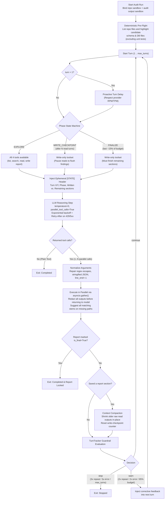

# Read-Only Codebase & Schema Auditor — An AI Engineering Study

> **Study Focus:** Exploring the real-world behavior of a single-agent **ReAct harness**, how **deterministic guardrails** turn an unreliable reasoning loop into a dependable system, and where a single-model setup begins to hit its architectural ceiling.


---

## 1. Study Objectives

This project is part of my ongoing **AI Engineering study**. Rather than treating an LLM as a black box that magically reads a repository and outputs a report, the goal here was to build a controlled experimental environment—a **Read-Only Codebase & Schema Auditor**—and observe how different models behave under a messy environment to accomplish a tasks.

The agent's task is concrete: inspect a target software repository (read-only), trace how the application defines and queries its database, catch discrepancies or risks (such as missing indexes, schema/ORM mismatches, or unsafe SQL), and write a grounded Markdown audit report with a Mermaid ERD and `path:line` citations.

Two core questions drove the study:

1. **How do guardrails shape agent reliability?**
   We started with three planned guardrails—**path sandboxing**, **PII/secret redaction**, and **turn/repetition tracking**—and let real failure modes reveal what additional guardrails were actually required in practice.
2. **What are the true limits of the ReAct pattern?**
   **ReAct** (Reason + Act) is a surprisingly weak pattern when left on its own, yet it underpins most modern agent workflows today. This study investigates *why* vanilla ReAct breaks down and how harness-level engineering (especially **parallel tool calling**, **phase gating**, and **context compaction**) fundamentally changes its performance.

---

## 2. Architecture & Agent Behavior Inside the Harness

At the center of the experiment is the agent harness in [`src/agent/harness.py`](src/agent/harness.py), sitting between the LLM and two sandboxed MCP tool servers (`read_path` for read-only inspection and `audit_report` for incremental Markdown writing).

Instead of trusting prompts alone to keep the model on track, the harness acts as an active control loop around every reasoning turn:



---

## 3. ReAct in Practice: Why Vanilla ReAct Is Weak — and How We Could Improved It

One of the central takeaways of this study is that **vanilla ReAct is fragile**. Left alone in a standard `think -> 1 tool call -> observe` loop, agents exhibit predictable failure modes:

- **Sequential inefficiency:** Calling one tool per turn forces the harness to resend the entire growing conversation history on every single file read. This inflates input token usage, slows execution, and rapidly exhausts provider Requests-Per-Minute (RPM) limits.
- **Endless exploration ("read -> read -> read"):** Driven by a completeness bias, models repeatedly open "just one more file" and run out of turns before writing a single word of the audit report.
- **Repetition loops:** When a search returns empty or a path fails, an unguided ReAct agent often retries the exact same call over and over.
- **Context bloat ("lost in the middle"):** As raw file slices pile up in memory, early workflow instructions fade from attention and reasoning quality degrades.

### Key Harness Improvements

| Limitation Observed | Harness Intervention | Observed Effect |
| :--- | :--- | :--- |
| Sequential 1-tool-per-turn bottleneck | **Parallel tool calling** via `asyncio.gather()` + `temperature=0` + `parallel_tool_calls=True` | Capable models now fire **6–10 tool calls in a single turn**, drastically cutting total API requests, input-token resends, and RPM hits. |
| Wasted Turn 1 orientation & noisy test reads | **Deterministic pre-flight mapping** before Turn 1 (filtering unit tests out of priority buckets) | Eliminates an entire LLM round-trip and primes Turn 1 to start immediately with parallel file reads rather than a single-call habit. |
| Model ignores soft prompts to write incrementally | **Harness-driven phase state machine** (`EXPLORE` → `WRITE_CHECKPOINT` → `FINALIZE`) + ephemeral `[STATE]` header | Physically pauses read tools at write checkpoints and during the final ~15% of turns so the agent flushes findings to Markdown instead of reading until timeout. |
| Growing token cost & attention drift | **In-place context compaction** triggered after report writes | Replaces bulky prior read/search payloads with compact metadata tombstones while preserving `tool_call_id` pairing, slashing TPM usage. |
| Tool validation loops (`request` stringification, regex escapes, `line_end=-1`) | **Flat MCP tool schemas** + defensive argument normalization + matching-stem path suggestions | Eliminates schema-induced retry loops across diverse model families and lets the agent choose among all matching filenames (e.g., `app/` vs. `src/`). |

---

## 4. Guardrails: Planned vs. Discovered Along the Way

A major lesson from building an agent from scratch is that **you rarely know all the guardrails you need on Day 1**. Roughly half of the guardrails were planned upfront as core study topics; the other half emerged empirically as we watched real runs fail.

### Planned Guardrails (Core Study Scope)
- **Sandboxing (`src/services/read_path.py`, `src/services/markdown_audit_report.py`):**
  Both the target codebase (`root_dir`) and the audit report destination (`output_dir`) are bound deterministically by the harness—never chosen freely by the agent. Symlinks, parent traversal (`../`), non-`.md` writes, and overwriting pre-existing files are blocked. Report filenames are automatically timestamped (`<agent_file_name>-mm-dd-yyyy-HH-MM.md`) so the model can name its own report without ever colliding with an older run.
- **PII & Secret Redaction (`src/guardrails/redact.py`):**
  Every tool response is scrubbed for credentials, API tokens, private keys, emails, IP addresses, SSNs, and phone numbers *before* entering the LLM's context—and again *before* any Markdown report is written to disk.
- **Turn & Repetition Tracking (`src/guardrails/track_turns.py`):**
  `TurnTracker` fingerprints every turn's tool calls. If the model repeats an action, the harness explicitly contextualizes what it just repeated and nudges it to try a different move. On a 3rd identical repeat or 3 consecutive error turns, a hard kill switch stops the run cleanly.

### Emergent Guardrails (Discovered Along the Way)
- **`.gitignore` Path Filtering (`src/guardrails/ignored_path.py`):**
  Without honoring `.gitignore` (and `.git/`), the agent quickly drowned in virtual environments, lock/build outputs, and generated files.
- **Dynamic Turn Budgeting (`src/guardrails/turn_counter.py`):**
  Early experiments showed that a hardcoded turn limit (such as `max_turns = 5`) was either far too small for real repositories or unnecessarily loose for tiny ones. Scaling the budget dynamically (`12` to `60` turns based on unignored file count) gave the agent realistic room to work.
- **Token & Pagination Caps:**
  Unbounded file reads or noisy search queries can blow out a context window in a single turn. Server-side token budgets (`MAX_READ_TOKENS`), paginated batches, per-file match limits, and report byte caps keep every tool call bounded.
- **Write-Only Tool Gating:**
  We discovered that soft text warnings (*"Budget almost exhausted, please write the report"*) are frequently ignored as long as read tools remain available. Removing read tools during `WRITE_CHECKPOINT` and `FINALIZE` turns turned a hopeful suggestion into a deterministic guarantee.
- **Provider-Aware Rate-Limit Handling & Schema Sanitization:**
  Different providers enforce very different RPM/TPM windows and JSON Schema dialects. Adding proactive turn pacing, `Retry-After` / `"retry in Xs"` exponential backoff, Gemini `thought_signature` preservation, and JSON Schema sanitization kept the harness portable across providers.

---

## 5. Model Benchmarks & Qualitative Observations

To evaluate how different model families interact with the same ReAct harness and guardrails, we tested three models across small and medium repositories:

| Model | Best Codebase Fit | Parallel Tool Calling | Speed | Diagram & Synthesis Quality | Key Behavioral Observations |
| :--- | :--- | :--- | :--- | :--- | :--- |
| **`gemini-2.5-flash`** | Medium codebases | **6–10 calls/turn** | Fast | **Strong** — produces clean, accurate Mermaid ERDs and balanced reports | Completed a small repo audit in **7 out of 16 turns** with high parallelism. Best overall balance between investigation, diagramming, and high-level findings. |
| **`nvidia/nemotron-3.5-lightning`** | Small to medium codebases | **6–9 calls/turn** | Very fast | **Weak** — struggles with diagrams | Reliably executes parallel tool calls at high speed, but tends to be overly technical—focusing heavily on implementation mechanics rather than stepping back to synthesize audit findings. |
| **`gpt-oss-20b`** | Small codebases | **None** (1 call/turn) | Fast | Basic | Fast per-turn inference, but unable to issue parallel tool calls. Sequential 1-call-per-turn behavior burns through turn budgets quickly and occasionally leaks internal formatting tokens into tool names on hosted endpoints. |

### Key Takeaway from Model Testing
Parallel tool calling is not just a latency optimization—it is an **economic and behavioral multiplier**. Moving from `gpt-oss-20b` (1 call/turn, frequently exhausting 16 turns) to `gemini-2.5-flash` (6–10 calls/turn, finishing in 7/16 turns) reduced both API pressure and context drift dramatically under the exact same harness.

---

## 6. Limitations & Reflection: Single-Agent vs. Multi-Agent

Even after hardening the single-agent ReAct loop with pre-flight mapping, parallel execution, phase gating, and context compaction, this study surfaced clear structural limits of a **single-model setup**:

1. **Context saturation on large repositories:**
   For small-to-medium repositories, a well-engineered single-agent harness is fast, economical, and easy to reason about. On large codebases or monorepos (100+ files, dozens of migrations and services), a single shared context still suffers from attention dilution, higher TPM pressure, and rising citation-error risk.
2. **Competing cognitive roles in one loop:**
   Asking one model inside one conversation thread to act simultaneously as *repository explorer*, *schema/query cross-checker*, *security/index critic*, and *technical writer + diagrammer* creates natural tension—as seen with `nemotron-3.5-lightning`, which excelled at fast technical exploration yet struggled to shift gears into concise findings and diagrams.
3. **Provider variance & rate-limit sensitivity:**
   Free-tier and open-weights hosted endpoints vary significantly in RPM limits, tool-call serialization reliability, and adherence to multi-step instructions.
4. **No Planner-Worker:**
   For this kind of task, the best approach for the harness is to enforce the planner-worker to cut-off the initial bloated prompt.

### Conclusion for Future Study
A single-agent harness should **not** be abandoned prematurely—fixing deterministic guardrails, phase control, and parallel execution unlocks far more capability than vanilla ReAct alone. However, once repository scale or role specialization becomes the bottleneck, the natural next step is **multi-agent orchestration**: splitting the workflow across isolated contexts (for example, a **Schema Extractor**, a **Query & Risk Auditor**, and a **Report Synthesizer / Verifier**) where faster exploratory models scan in parallel and a stronger synthesis model produces the final findings and diagrams.

---

## 7. Reproducing the Study

### Prerequisites
- Python `3.13+`
- [`uv`](https://docs.astral.sh/uv/) package manager
- An OpenAI-compatible API endpoint (Gemini OpenAI bridge, OpenRouter, OpenAI, or local Ollama)

### Setup & Configuration

1. Install dependencies:
   ```bash
   uv sync
   ```
2. Create a `.env` file in the project root:
   ```env
   OLLAMA_PROVIDER_URL=https://your-provider-url // either ollama, openrauter, openai
   OLLAMA_API_KEY=your_api_key_here
   OLLAMA_MODEL_NAME=google/gemini-2.5-flash

   # Optional harness & rate-limit tuning
   LLM_TEMPERATURE=0.0
   LLM_PARALLEL_TOOL_CALLS=true
   LLM_WRITE_CHECKPOINT_TURNS=3
   LLM_TURN_DELAY_SECONDS=4.0
   LLM_MAX_RETRIES=5
   ```
3. Point `repo_path` and `audit_path` in [`src/main.py`](src/main.py) to your target repository and desired report output folder, then run:
   ```bash
   uv run src/main.py
   ```

### Running the Test Suite
```bash
uv run pytest -v
```

---

Portfolio: **[Benjineer](https://benjineer.vercel.app)**
Email: benjicanones6@gmail.com

---

- Yao, S., Zhao, J., Yu, D., Du, N., Shafran, I., Narasimhan, K., & Cao, Y. (2022). *ReAct: Synergizing Reasoning and Acting in Language Models*. [arXiv:2210.03629](https://arxiv.org/abs/2210.03629)

---
